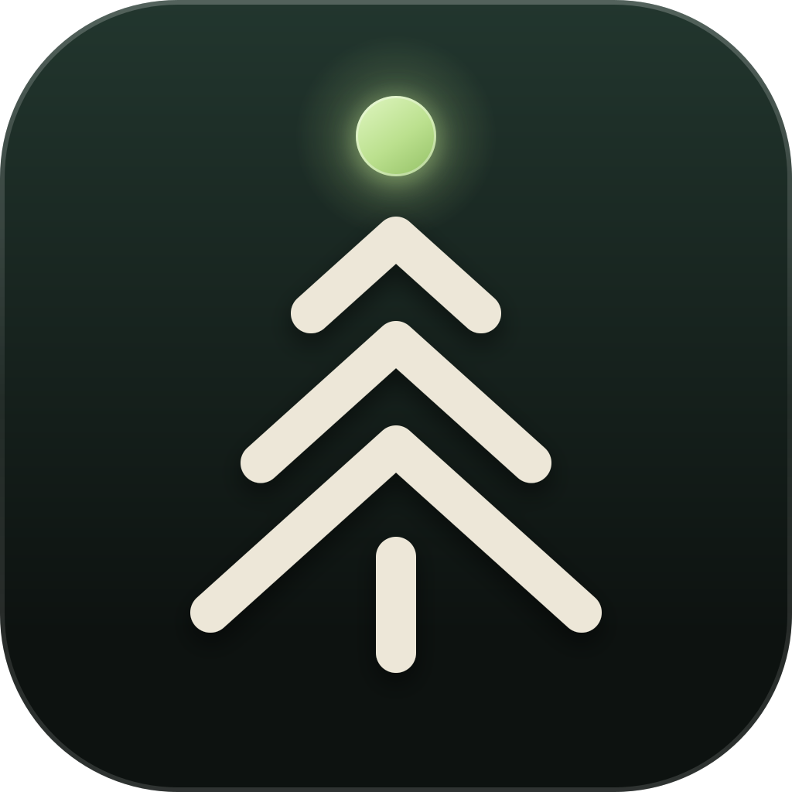

# Bruk

A native macOS desktop application built in **Rust** with **[Native Shell (`nsh`)](https://nsh.dev)** for orchestrating AI workflows across software projects.

## Architecture

This repository is a Cargo workspace split into two crates:

- **`crates/factory-core`** — Pure Rust domain model, the Bruk folder (`BrukHome`), SQLite project persistence (`ProjectDatabase`), and workflow execution engine (`Project`, `Workflow`, `WorkflowStep`, `WorkflowRun`, `StepExecutor`, and `FactoryState`), independent of UI/AppKit so workflows can be tested or reused from a CLI or daemon.
- **`crates/factory-app`** — Native Shell (`nsh-core`, `nsh-base`, `nsh-platform-macos`) macOS AppKit desktop application providing first-launch setup, a Project Registration view (clone into the Bruk folder or link an existing clone), project & workflow sidebar, task launcher, run list, and step/log inspector.
- **`nsh.json`** — Native Shell manifest pointing at `crates/factory-app` and its `App` root component.

## The Bruk Folder

Everything Bruk stores lives in one folder, `~/Bruk` by default:

```text
~/Bruk/
├── bruk.db           SQLite: projects, preferences, project settings, secrets, run history, chats and their token use
├── projects/<name>/  Repositories Bruk cloned for you
├── runs/<run-id>/    Per-run step bundles and isolated git worktrees
├── chats/<chat-id>/  Per-chat agent instructions, Codex's isolated home, attachments, and the chat's worktree
└── cache/modules/    Git modules fetched for .agents/bruk/bruk.yaml
```

On first launch Bruk asks where to create this folder. Picking anything other than `~/Bruk`
is remembered in `~/Library/Application Support/Bruk/location` (one line, the folder's path).
Choosing a folder that already contains `bruk.db` reuses it as-is.

Projects come in two kinds:

- **Cloned** — Bruk runs `git clone` into the default projects directory, which is
  `projects/<name>` in the Bruk folder unless changed in Preferences › General (accepts any git
  URL, scp-style address, local path, or GitHub `owner/repo` shorthand).
- **External** — a clone you already have stays where it is; Bruk only records its path.

Removing a project from Bruk never deletes its files.

Data from the old location (`~/Library/Application Support/software-factory/factory.db`) is
offered for a one-time import during setup; the original file is left untouched.

Set `BRUK_HOME` to use a specific folder and skip setup (handy for development).

## Chats

Next to workflows, each project has **Chats**: open-ended conversations with one of its agents
(sidebar › project › Chats, or File › New Chat, ⌘T). A new chat picks a provider (Claude, or
Codex or Antigravity once added in Settings), an optional agent from the project's `.agents/bruk` catalog,
what the agent may do (Read-only, Workspace write, Full access; changeable later), and where it
works:

- **Project checkout**: the agent works in your checkout, next to your own edits.
- **New worktree** (git projects): the first message creates a worktree in
  `chats/<chat-id>/worktree` on a new branch from `HEAD`, named after the message
  (`<branch prefix>chat-<title>`). The checkout is left alone. Deleting the chat removes the worktree,
  including uncommitted changes; the branch and its commits stay.

Each message runs one non-interactive turn of the provider CLI and resumes the provider's own
session (`claude --resume <id>`, `codex exec … resume <id>`, `agy --conversation <id>`), so the agent keeps the whole
conversation. Turns get the same user-context isolation as workflow steps: only the chosen agent
and the skills and subagents it declares, plus the repository's own instructions. Replies stream
in as Markdown, with tool calls shown inline; transcripts are kept in `bruk.db`.

**Attachments**: drop files on the chat, paste them into the composer (a screenshot, or files
copied in Finder), or pick them with the paper clip. Any file up to 100 MB can go with a message.
When it's sent, each file is copied into `chats/<chat-id>/attachments/`, so the chat keeps its
own copy, deleted along with the chat. The message lists every attachment's path, and the folder
is added to what the agent may read (`--add-dir`). PNG, JPEG, GIF and WebP images also go to the
model directly: Claude gets them as image blocks of a stream-json message (up to 3.75 MB each;
larger ones are passed by path only), and Codex gets them with `--image`. Antigravity reads every
attachment by path.

After each reply Bruk measures the agent's **context window**: the header shows how full it is,
and the Context panel breaks it down. For Claude the breakdown covers system prompt, tools,
memory files, skills, messages, the autocompact buffer and free space. Claude Code reports this
for an unsaved fork of the session, so the chat itself is untouched and no model is called.
Codex reports only the total, read from its own record of the thread; Antigravity reports
only the total too, read through `agy acp` without calling a model.

### Antigravity

Antigravity (`agy`) is added from Settings › Providers › Add Account, like Codex, and uses your
existing Antigravity login. Bruk checks the login and lists models with `agy models`, and
reads the 5-hour and weekly quota with `agy --print=/usage`; neither spends quota. Every `agy`
Bruk starts runs with `AGY_CLI_DISABLE_AUTO_UPDATE=true`.

Turns run in print mode with slash commands off. The agent's instructions are sent ahead of
the first message, and access maps onto Antigravity's permission rules:

- **Read-only**: file edits, commands and MCP tools are denied, inside the terminal sandbox.
- **Workspace write**: file edits and commands are allowed, inside the terminal sandbox.
- **Full access**: every tool is approved (`--dangerously-skip-permissions`).

Antigravity can't be pointed at a separate config folder in print mode, so unlike Claude and
Codex its turns still load your own rules, skills, plugins and MCP servers from
`~/.gemini/config`.

Every token and cent a chat uses is recorded per turn and counted on the **Dashboard** next to
workflow runs, even after the chat is deleted.

## Prerequisites

- macOS 14+ with Xcode Command Line Tools (`xcode-select --install`)
- Rust 1.97+ (`rustup`)
- *(Optional, for `.app` packaging and `nsh` CLI workflows)* Install the Native Shell CLI:
  ```sh
  curl -fsSL https://nsh.dev/install.sh | sh
  ```

## Development Commands

Common tasks are orchestrated with [Task](https://taskfile.dev/) via [Taskfile.yml](Taskfile.yml):

```sh
task                 # List all tasks
task run             # Run the native macOS app via Cargo (alias: task dev)
task test            # Run all unit + headless Native Shell UI tests
task test:core       # Run factory-core unit & SQLite tests
task test:ui         # Run factory-app headless UI tests
task fmt             # Format Rust code
task lint            # Run Clippy with -D warnings
task ci              # Run fmt:check, lint, test, and build
task db:path         # Show the active Bruk folder database path
task nsh:install     # Install/update the Native Shell CLI (v0.6.1)
task run:nsh         # Run with Native Shell CLI
task package         # Build .nsh/out/Bruk.app
task package:run     # Build and launch .nsh/out/Bruk.app
task package:universal # Build a universal (arm64 + x86_64) macOS .app bundle
```

Direct Cargo / Native Shell commands also work:

```sh
cargo run
cargo test --workspace
nsh run --target macos
nsh package --target macos
```
